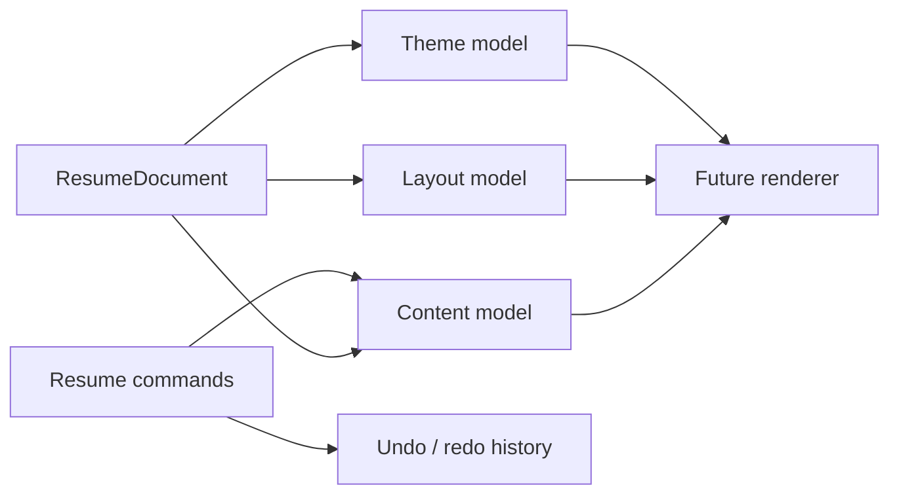

# Resume Builder V2 Core

> A TypeScript domain core for versioned, localized resume documents. It defines the document model and safe editing transitions; it does not pretend to be a finished resume UI.

## Overview

This repository is the V2 domain layer for a resume builder. It keeps resume content, layout, and theme data separate so the same document can later power browser rendering, local storage, and PDF/DOCX adapters.

The current snapshot intentionally stops at the serializable core. React screens, template rendering, import/export adapters, and a packaged application are not part of this repository yet.

## Implemented capabilities

- Versioned `ResumeDocument` contracts with stable branded entity IDs.
- Separate content, layout, theme, locale, and asset models.
- Localized profile, experience, education, project, skill, certification, language, and custom content structures.
- Command-based updates with field allow-lists, path validation, inverse commands, and revision bumps.
- Undo/redo history with bounded past/future stacks.
- Serialization and validation helpers for JSON-safe persistence.
- Example resume data and focused Vitest coverage for document creation, commands, serialization, validation, and history.

## Model map



## Showcase

This is a domain library rather than a visual application, so there is no honest runtime UI screenshot to include yet. The [data-model design](./docs/resume-data-model.md) and [example document](./src/data/exampleResume.ts) are the current canonical project walkthroughs.

## Tech stack

- TypeScript 5.9 with strict, ESM-compatible types
- Vitest 3 for unit tests
- JSON-serializable domain contracts with no DOM, React, or browser-storage dependency

## Current status

**Implemented:** the V2 data model, command transitions, validation, serialization, and bounded undo/redo history.

**Not implemented here:** React UI, template renderer, drag-and-drop layout editor, persistence adapter, import/export integrations, and PDF/DOCX generation.

## Quick start

```bash
npm install
npm run check
```

`npm run check` runs the strict TypeScript check followed by the Vitest suite.

## Project structure

```text
src/types/                 # Serializable resume domain contracts
src/core/resume/           # Creation, validation, serialization, commands
src/core/history/          # Undo/redo transitions and history state
src/data/exampleResume.ts  # Example document fixture
docs/                      # Data-model design notes
```

## License

No license has been declared yet.
